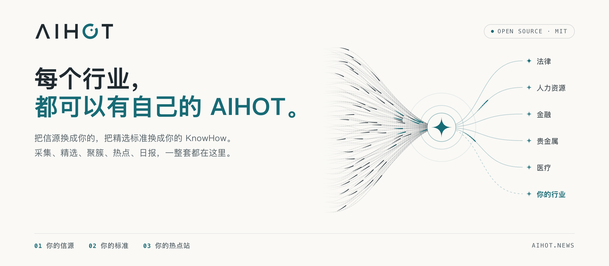

<p align="right">
  <a href="README.en.md">English</a> | <b>繁體中文</b>
</p>

<p align="center">
  <picture>
    <source media="(prefers-color-scheme: dark)" srcset="docs/assets/banner-dark.png">
    
  </picture>
</p>

<p align="center">
  <a href="LICENSE"></a>
  
  
  
  <a href="https://aihot.news"></a>
</p>

<p align="center">
  <b>一套自動找熱點、寫日報的網站框架。</b><br>
  換上你的信源與精選標準，就能建立自己的行業熱點站。
</p>

<p align="center">
  <a href="#快速開始">快速開始</a> ·
  <a href="docs/customize.md">改成你的行業</a> ·
  <a href="#運作方式">運作方式</a> ·
  <a href="#文件">文件</a> ·
  <a href="FORK.md">Fork 維護說明</a>
</p>

> **Fork 說明**：本專案維護自 [KKKKhazix/AIHOT](https://github.com/KKKKhazix/AIHOT)。維護策略見 [`FORK.md`](FORK.md)，逐檔差異見 [`docs/DIVERGENCE.md`](docs/DIVERGENCE.md)，上游審查紀錄見 [`docs/UPSTREAM.md`](docs/UPSTREAM.md)。

## 這是什麼

[AIHOT](https://aihot.news) 是 AI 熱點與新聞彙整系統。它每天從多個信源收取資料，先由大型語言模型預篩，再做兩次獨立評分，產生中文標題、摘要與推薦理由。不同來源報導的同一件事會合併成事件，依獨立來源數與時間衰減計算熱度。

本倉庫包含網站、管理後台、精選流程、事件歸組、熱度算法，以及所有 Prompt 與入選門檻。

## 運作方式

```text
信源 → 判重／預篩 → 雙重評分與寫作 → 事件歸組 → 熱度排序
                                      └→ 日報 → 週報／月報
```

- **事件歸組**：先用最近兩週的標題與摘要向量找候選；未設定向量服務時改比文字重合度，再讓模型判斷是否為同一事件或後續進展。
- **熱度**：48 小時內每個獨立來源只計一次，分數每 24 小時減半。同一媒體大量轉貼不會重複加分。
- **精選與成刊**：同一則新聞只留一條；日報依規則成刊，不呼叫模型。週報與月報從日報彙編，模型只寫總述與欄目導讀。

## 主要功能

| 功能 | 說明 |
|---|---|
| 多元信源 | RSS、網頁列表、JSON API、X、微信公眾號與外部推送；支援信源分級與自動調整抓取頻率 |
| 雙重精選 | 預篩、兩次獨立評分、分級門檻與去除同新聞重複；可用 SelectBench 校準 |
| 寫作 | 中文標題、結論先行摘要、推薦理由、翻譯、分類、標籤與新聞事實抽取 |
| 事件與熱點 | 跨來源歸組、事件綜述、時間線排序切換、獨立來源熱度與趨勢標記 |
| 日報／週報／月報 | 每日出日報（預設 08:00）；週一出週報、每月 1 日出月報（預設 10:00、10:30）；出刊時間在 `site/site.ts` 的 `EDITION_TIMES` 調整 |
| 主題與搜尋 | 公司、方向、內容形態主題頁；標題摘要與全文搜尋 |
| 閱讀設定 | 深淺色外觀、網站預設字體或瀏覽器字體；收藏與閱讀設定只存在本機，可匯出、匯入備份 |
| Agent 出口 | RSS、公開 API、MCP、Agent Markdown、`llms.txt` 與 OpenAPI 3.0.0 |
| 管理後台 | 信源管理與試抓、內容診斷、精選評測、模型路由、預算熔斷、執行紀錄與告警 |

## 快速開始

需要 [Docker](https://docs.docker.com/get-started/get-docker/)、[Node.js 24](https://nodejs.org/en/download)（執行 `init-env` 產生設定用）與相容 OpenAI 格式的模型 API Key（例如 DeepSeek、千問、智譜）。`init-env` 預設按 DeepSeek 設定；改用千問、智譜等，依 `.env.example` 修改 `.env` 的 `LLM_BASE_URL`、`LLM_MODEL` 與 `LLM_EXTRA_JSON`；使用推理模型時另設 `LLM_REASONING_TOKENS` 為推理留出輸出額度。

```bash
git clone https://github.com/SanHsien/AIHOT.git myhot
cd myhot
node scripts/init-env.ts --llm-key <你的模型_API_KEY>
docker compose up -d --build
```

打開 <http://localhost:3000>；管理後台在 `/admin`，密碼位於 `.env` 的 `ADMIN_PASSWORD`。系統通常一至兩分鐘後開始收集內容，首次匯入約需半小時。站點啟動後，打開 `/agent` 可複製 MCP、RSS 或 API 的接入方式；只能讀網頁的 Agent 從 `/api/v1/agent` 開始，介面說明在 `/openapi-v1.json`。不使用 Docker、直接在 Linux／macOS 執行（Windows 用 WSL2）見 [部署](docs/deploy.md)。

## 改成自己的行業

站點自己的內容集中在 [`site/`](site/)，行業知識集中在 [`industry/`](industry/)：

| 檔案 | 用途 |
|---|---|
| `site/site.ts` | 站名、行業詞、出刊時間、首頁與關於頁文案、條目與日報週報月報上的說法、公開介面的分類 |
| `site/models.ts` | 每一步預設使用的模型（不改則都用 `.env` 設定的那一個） |
| `site/brand/`、`site/pages/`、`site/public/`、`site/changelog.json` | 圖標與 Logo、使用規則與隱私說明、`robots.txt` 這類發布在網站根目錄的檔案、更新日誌 |
| `industry/taxonomy.ts`、`industry/topics.json` | 分類、標籤與主題 |
| `industry/sources.json` | 初始信源 |
| `industry/prompts/` | 精選與寫作標準 |
| `industry/selection.ts` | 入選門檻 |
| `modules/` | 框架裡沒有、只有你的站需要的功能，做成模組放這裡（見 [架構](docs/architecture.md#模块)） |

最值得投入的是 `industry/prompts/selection-score.md` 與入選門檻。先標註一至兩百筆樣本，再依 [`docs/selection.md`](docs/selection.md) 執行 `scripts/eval-selection.ts` 校準。

## 本機開發與驗證

```bash
npm install
bash tools/dev_check.sh
```

有 PostgreSQL 測試資料庫時，再執行完整整合測試：

```bash
DATABASE_URL=postgres://127.0.0.1:5432/aihot_test npm test
```

## 文件

- [自訂行業](docs/customize.md)：站名、分類、主題、信源、提示詞、門檻、模型與品牌。
- [信源](docs/sources.md)：六種信源、分級、全文與外部推送。
- [精選與校準](docs/selection.md)：精選、日週月報成刊與樣本校準。
- [事件歸組](docs/grouping.md)：事件關係與 pairwise gold set 評測。
- [綜述評測](docs/story-digest-evaluation.md)：修改事件綜述提示詞前，在同一批事件上並排比較。
- [部署](docs/deploy.md)：Docker、域名、HTTPS、更新、備份與費用。
- [架構](docs/architecture.md)：服務、資料流、模組、資料庫遷移與公開出口。
- [Fork 維護](FORK.md)：維護策略與邊界。
- [上游審查](docs/UPSTREAM.md)：已評估的 commit、PR、issue、branch、tag 與 release。

## 授權與商標

程式碼採 [MIT 授權](LICENSE)。**AIHOT 名稱與 Logo 不在 MIT 授權範圍內**；自行部署時請改用自己的品牌。第三方字型與標誌歸原權利人所有，詳見 [NOTICE](NOTICE) 與 [NOTICE.md](NOTICE.md)。
